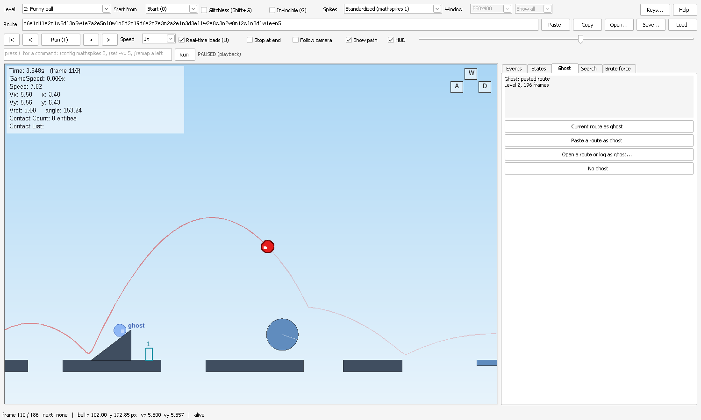

# rbsim — bit-exact Red Ball 1 simulator

A C++17 port of the Box2DFlash 2.0.x engine embedded in *Red Ball 1* (practice-hack / tournament
SWFs; their Box2D code is byte-identical), plus all of the game-side logic: the 17 level scripts,
display-layer hit tests, camera, standardized spikes, death and death warps. It is the foundation
for TAS route work.

**Reference:** Flash Player **11.4.402.287** with the Practice Hack, `MATHSPIKES = 1`, spike glitch
on (`isGless` off; glitchless mode is supported too). "Bit-exact" means every logged value of every
frame matches that Flash Player to the last bit.

## Status

| | |
|---|---|
| levels | **all 17 bit-exact** against Flash logs: 83 logs, 99,170 frames, every death and win on Flash's frame |
| display layer | ported from Flash Player 11.4 itself (decompiled, `docs/FLASH_PLAYER_RE.md`) and checked against every dump: rotation matrices, hit-test boxes, camera, plain spikes (E8c 30,000/30,000), turned/scaled spikes (E11 390,670/390,670), the turned Level 11 flag (E12 148,074/148,074) |
| real-game spikes | the original game's / Tournament Edition's pixel spike test (`--mathspikes 0`) at any window size and scale mode, including the moving-camera spike glitch: 28 real-time Flash playbacks bit-exact to the death frame (`docs/RESOLUTION.md`) |
| death | death warps (onto checkpoints, flags, a moving flag, the Level 16 wrong-way trigger) and real-game pause timing |
| platforms | Linux and Windows (x86-64), identical results; `rbview.exe`: the Practice Hack's TAS mode for Windows (same keys) with savestates, ghost and route viewer |
| smartforce | `rbsim smartforce`: simulates every string of an input pattern and reports those meeting conditions |
| tests | `rbsim test`: 97 self-tests; `make tastest`: the TAS core of the viewer |

## What's new in v2.0

- **Red Ball TAS (`rbview.exe`)** is now the Practice Hack's TAS mode on the simulator: the mod's keys and
  behaviour, with a proper UI (below). New since v1.2:
  - savestates without a limit, with names, kept in a file, plus backups of every route a restart, rewind or
    load replaced;
  - a ghost route to race against, and the jump brute-forcer's candidates actually simulated;
  - every setting the mod has as a key or a command is also a checkbox or slider (Options tab);
  - Space can be held to keep stepping while you press other keys;
  - the HUD grows with the window and shows the distance to the flag and the jump probes (also drawn under
    the ball, Shift+J);
  - spike hitboxes are drawn as the game tests them (Shift+H). Under `mathspikes 0` they are the exact window
    pixels that kill at the chosen window size;
  - the view follows the game camera unless you drag it.
- **`rbsim smartforce`** (contributed by @donaldkabelhdmi in PR #2) simulates every input string of a
  hand-written pattern and lists those that meet your conditions (section below). It replaces `rbsim optimize`,
  `rbsim beam` and the viewer's Search tab; those are in the git history up to commit `7a21128`.
- **Faster engine** (PR #2): exact shortcuts, 1.31x on Level 14 replays. The results are unchanged bit for
  bit: per-frame full-state digests match the previous engine on 2,040 random runs over all 17 levels,
  checkpoints, restarts and the three spike rules.
- **Fixes:**
  - Level 15 started from a checkpoint and then from the beginning closed the program ("new body name after
    template freeze"). The loose plank exists only from the level start; every start is now registered when
    a level is first built.
  - Drop platforms re-created more than 96 times (riding one on Level 4, 6 or 14) closed the program ("body
    capacity exceeded"). The slots of destroyed bodies are now reused, only once the slots run out, so
    verified routes are unchanged.
  - Windows: a crash when worker threads ended (the physics scratch buffers now use fiber-local storage).

## Red Ball TAS / route viewer (Windows, no command line)

**[⬇ Download rbview.exe](https://github.com/Theme25/project-unnamed/releases/latest/download/rbview.exe)**
(latest release; one file, no installer). Windows may show "Windows protected your PC" the first time
because the exe is not signed: click **More info**, then **Run anyway**.

`rbview.exe` is the Practice Hack's TAS mode on the bit-exact simulator: **the same keys and behaviour as the
mod** (A/W/D to play, T pause, Space frame advance, `,` `.` speed, 0-9 / Shift+0-9 states, I/O import/export,
Backspace rewind, R/F restarts, G invincibility, Shift+G glitchless, H/J overlays, B/Shift+B jump brute-forcer,
`/config`, `/set` warps, `/remap`), with a proper UI around it:
- savestates without a limit, with names, kept in a file, plus backups of every route a restart, rewind or load
  replaced;
- a ghost route to race against;
- the jump brute-forcer's candidates actually simulated;
- remappable keys that stay out of the way while you type, and every setting as a checkbox or slider;
- the route viewer: seek any frame, events list, death-warp ghost, path, a HUD that scales with the window
  (distance to the flag, jump probes), spike hitboxes as the game tests them, Flash's spike test at any window
  size.
Guide and full key list: [`docs/WINDOWS.md`](docs/WINDOWS.md).
Build: `make viewer` (MinGW-w64 cross build; Win32 + GDI+, static; source in `viewer/`: `tas.cpp` is the TAS logic
without Windows code, checked natively by `make tastest && viewer/tas_test`).
To publish a new version: create a GitHub release (new tag, e.g. `v2.0`) and attach the exe named
exactly `rbview.exe`, so the download link above keeps pointing at the newest one
(`gh release create v2.0 rbview.exe rbsim.exe --title "..." --notes "..."` does the same from the command line).



## Build & run

**Linux / WSL / Codespaces:** `make`. **Windows:** see [Windows](#windows) below, or
[`docs/WINDOWS.md`](docs/WINDOWS.md) to just use the ready-made exe.

```
make                 # see "Build flags" below; do not change them
./rbsim test         # 97 self-tests (physics, display layer, spikes, death warps, all 17 levels, snapshots, ...)
./rbsim run --level 2 --inputs "n20w1d25n40" [--hex] [--every N] [--checkpoint K]
./rbsim log --level 2 --inputs "..."      # simulator log in the Flash mod's TSV format
./rbsim bench [--frames N]                # throughput
./rbsim verify rb1_stats.tsv [--verbose N] [--ignore sr,...] [--gless 0|1] [--trig intel|glibc]
./rbsim calib rb1_calib.tsv                # checks a calibration dump (docs/STATS_LOGGING.md)
./rbsim smartforce --level N --inputs PATTERN --report CONDITIONS   # try many routes at once, see below
# any command: --mathspikes 1|2 picks the spike rule (docs/MATHSPIKES_RESOLUTION.md);
#   --mathspikes 0 --window WxH [--noscale]: the original game / Tournament Edition at that window (docs/RESOLUTION.md)
make framescan && tools/framescan rb1_stats.tsv      # checks the frame-scan mod's edge scans (docs/RESOLUTION.md)
make deathcause && tools/deathcause <level> <RLE> [checkpoint] [gless]   # what killed the ball, when
```

`run` prints position, velocity, angle, angular velocity, ground probes (L/C/R), contact count,
alive and sleep flags per frame (`--hex`: raw IEEE-754 bits). Inputs use the game's RLE format
(`n d w e a S q W` = none, right, up, up+right, left, left+right, left+up, all three, each followed by
a frame count; `R` = checkpoint restart).

`verify` replays a stats log recorded with the logging mod and compares every field of every frame.
It detects per segment whether the recording had `isGless` on (`--gless` forces it), takes the spike rule, window
size and scale mode from the log's `#ENV` line, and also reports how many hit-test decisions came within a rounding
unit of flipping (should be 0).

### Windows

**Just want to run it?** See [`docs/WINDOWS.md`](docs/WINDOWS.md).

Two ways to build, both giving a static `rbsim.exe` (no DLLs needed) with the same results as Linux:

1. **Native, with MSYS2:** install [MSYS2](https://www.msys2.org/), open the **MSYS2 UCRT64** shell, then
   ```
   pacman -S --needed mingw-w64-ucrt-x86_64-gcc make git
   git clone <repo> && cd project-unnamed
   make            # produces rbsim.exe
   ./rbsim.exe test
   ```
2. **Cross-compiled on Linux:** `apt install mingw-w64`, then `make windows`.

MSVC is not supported: Flash's `sin`/`cos` (`src/libm_intel.S`) is GNU assembly, wrapped on Windows
to preserve the registers the Windows x64 calling convention requires. The simulator does not depend
on the host's math library (it only uses exact functions: `sqrt`, `fmod`, `floor`, `trunc`).

Checked under Wine 9 after every change: all self-tests, the calibration dumps and the stats logs give
the same results as Linux.

**Build flags:** use the Makefile's (`-O2 -ffp-contract=off -fno-fast-math
-fexcess-precision=standard`, `-pthread`). `-O3 -march=native` breaks bit-exactness on Levels 3, 8
and 12 and is not faster. Never add fast-math, FMA contraction or `-march` flags.

## Trying many routes at once: `rbsim smartforce`

```
rbsim smartforce --level N --inputs PATTERN [--report CONDITIONS] [--checkpoint C] [--gless] [--pad N]
                 [--threads N] [--top N] [--list] [--names] [--idle-up] [--hardfilter [--tolerance T]]
                 [--merge-report] [--maxmem GB] [--stochastic [--time SEC] [--samples N] [--seed S]]
                 [--sortby [-]Q] [--save [FILE]]
```

`--save` writes the result rows to a file when the search ends (also after Ctrl+C): all rows kept, not
just `--top`, after comment lines with the command, the start time and (`--stochastic`) the seed; each row's
inputs are on an indented line of their own, so long strings wrap without breaking the columns. The file is
`smartforce-L8-2026-10-24-153207.txt` in the current folder by default, or `--save FILE` (a name ending in
`/` or `\` is a folder for the automatic name; folders are created). It is created when the search starts,
so a bad path is reported at once. An existing file is never overwritten: `-2`, `-3`, ... is added before
the extension.

Rows come by frame, then flag. `--sortby Q` (`frame px py vx vy flag`) orders them, the `--stochastic` best
10 and which rows are kept when memory runs short by that column instead, highest first; `--sortby -Q` lowest
first. Ties go by frame, then flag; for `px py vx vy` dead rows come last.

Simulates every string a pattern expands to and lists those that meet all the conditions. Meant for
routes worked out by hand: fix what is understood, enumerate the rest.

| pattern | means |
|---|---|
| `d18 n3` | runs as in a TAS string (a letter without a count is 1 frame) |
| `d4..7` | every count from 4 to 7 (`d0..3`: the run may be absent) |
| `(A\|B\|C)` | alternatives, each a sub-pattern (they nest) |
| `(...)=6`, `(...)=4..6` | only the group's expansions that are 6 (4 to 6) frames long |
| `<BASE:a3>` | every way to overwrite 3 single frames of BASE (any sub-pattern) with `a`: `<n20:a3>`, `<d18e3:n2>` |
| `<BASE+a3>` | the same, but `a` is added to the keys already held there: `<d20+a1>` puts one `S` (left+right) into `d20` |
| `<BASE:a1..3>`, `<BASE+a0..2>` | every tap count in the range, for either form; 0 includes BASE unchanged |
| `<BASE:a1,w1>`, `<n20:a1..2,w0..1>` | several tap kinds, each with its own count or range, always on different frames (`<<BASE:a1>:w1>` instead lets the `w` overwrite the `a`) |

`d18(e1..6d0..5)=6<n4:a1>(d4..7e7..10)=14` is 6 x 4 x 4 = 96 strings (`--list` prints them). `R` is not
allowed.

Strings come shortest first, then in written order (alternatives left to right; in a sequence the first
part changes slowest; a placement's base before its taps). Each part of the pattern counts its strings by
length, so string number i can be built directly from i (unranking). Every part is expanded in memory, with
repeated strings removed, if its predicted size fits in `--maxmem GB` (default 4; about 72 bytes + 1 per
frame per string). A part that does not fit is generated one string at a time in the same order instead:
no size limit (counts up to 4.6e18), but repeated strings (`a1,a1`, or a tap that changes nothing) are
kept and played twice unless `--hardfilter` merges them. The header marks generated parts with `*`.
The `--hardfilter` table (at most 48 bytes per state), the result rows and the game states kept for shared
prefixes (below) also stay within `--maxmem`: when their share is used up, new states are no longer added to
the table, only the best rows are kept (the output says so) and fewer prefixes are kept.
`--maxmem` may not exceed the PC's memory, the threads' game states (about 175 KB per pattern part per
thread) must fit in it, and the counting tables count towards it too. Patterns that would take more than
400 million steps just to count, or brackets nested more than 200 deep, are refused with a message, and
running out of memory stops the search with the results so far instead of crashing.

Conditions (`--report`, comma-separated, all must hold; default `win`): `win`, `dead`, `alive`, `ground`
(a jump probe touches), `contact`, `contact=NAME` (`--names` lists a level's bodies), and comparisons
`Q<V Q<=V Q>V Q>=V Q=V` with Q one of `px py vx vy vr` (the Practice Hack HUD's and `/set`'s units: metres, m/s,
`vr` = 0.35 x the angular velocity; `px py` are `run`'s x and y), `pr` (rotation in degrees as the HUD shows it: `run`'s angle x 180/pi, fmod 360,
so negative after turning backwards) and `flag` (distance from the ball's box to the flag's box in twips:
the larger of the x and y gaps; <= 0 means touching, minus the overlap depth). Each may have a frame window:
`@F`, `@A..B`, `@..B`, `@A..`. Frames are the game's (the flag frame is the one the game's timer shows).

- Strings that share a prefix share its simulation (the state is copied where the pattern branches),
  also inside a part: each option of a part starts from the state at the longest run of inputs it shares
  with the option before it (`<d76+w2>`: from where its taps first differ). The work is split
  over all threads, each taking a range of options. With `--stochastic`, the states after the first parts
  are kept once per choice of them (up to 256 per thread), so a sample plays only the rest. None of this
  changes a result: the same strings are played and merged, only faster.
- A string is decided on the frame all conditions hold; the rest of it is not played. It is dropped as
  soon as a window has passed, or when the ball is dead and no condition can still hold. Strings that
  agree up to the deciding frame are listed once, with their count.
- Up held on a frame where it does nothing is written as the same keys without Up: the ball is awake,
  does not jump (a jump needs a contact and a foot probe) and gets no lift (that needs vy < 0), so the game
  plays both byte-identically. `--idle-up` keeps the strings as written.
- `--hardfilter` merges strings that are in the same game state at the same point of the pattern with the
  same inputs still to play, however different their pasts (inputs that cancel out lead back to the same
  state): only the first is played on and listed, the rest are counted as merged. The check runs between
  the parts of the pattern and every `--merge-every N` frames inside a part (default 32; 0: only between
  parts; 32 found nearly all of 16's extra merges at no extra cost on the Level 8 tests). States are compared without what the game
  never reads again (freed contact slots, manifold points past `pointCount`, the normal of an empty
  manifold, the two speed-up caches, scratch arrays past their counts, the probe and `upIdle` flags), and
  doubles count as equal within `--tolerance T` (default 1e-10, rounded to a grid of that size; `0` =
  bit-exact). With a tolerance the merge is a heuristic, since a 1e-10 difference can grow; on the test
  patterns the merged runs reached the same positions as the unmerged ones. `--merge-report` lists what
  still differs between states whose bodies agree to 1e-7 but that were not merged (`--raw-states`: compare
  the full state, to see what the cleaning gains).
- A string ends where the pattern ends: `--pad N` plays N more `n` frames after it (for example to let
  the ball roll on to the flag).
- Output: the matches by deciding frame (then by distance to the flag), with px, py, vx, vy and the distance
  to the flag on that frame.
- `--stochastic` plays the strings in a uniformly random order without repeats and without storing them:
  string number c is mapped through a keyed bijection of [0, N) (an 8-round Feistel network with
  cycle-walking), so every string is equally likely at every step and a run that finishes has played each
  string exactly once. It runs until every string is played or Ctrl+C, or for `--time SEC` or `--samples N`,
  and every `--update SEC` (default 60, 0: off) prints the time, how many strings it has played and how
  fast (overall and since the last update), then the 10 best strings so far; nothing else is printed while
  it runs. `--seed S` repeats a run (the seed is printed). Above 4.6e18
  strings it picks each part independently at random instead (repeats then possible but vanishingly rare).
  `--hardfilter` works here too: a sample is merged when its state and its remaining inputs match an earlier
  one's. Ctrl+C stops any search and prints the results so far.

## Architecture

| file | contents |
|---|---|
| `src/b2math.h` | AS3-exact vector/matrix/sweep math; `Number.MIN_VALUE` epsilons; the single `as3_sin/as3_cos` choke point |
| `src/libm_intel.S` | Flash Player 11.4's `sin`/`cos` (Intel LIBM, generated by `tools/hotspot2gas.py`) |
| `src/b2collision.cpp` | polygon geometry, circle/poly narrow phase, GJK distance, TOI |
| `src/b2world.cpp` / `b2world.h` | SAP broadphase, pair manager, contact lifecycle and listener emulation, island + contact solver, TOI loop, bodies/shapes, filtering |
| `src/b2joints.cpp` | distance, prismatic (limits, motors) and revolute (motors) joints |
| `src/redball.cpp` / `redball.h` | base `Level` logic (construction, sprite sync, probes, input, camera, display layer, spikes, death and post-death update), the 17 level scripts, RLE codec |
| `src/levels_data.h` | named placements of all 17 levels (`tools/extract_levels.py`, `tools/gen_levels_data.py`) |
| `src/level_polys.h` | polygon tables of levels 9-17 as written in the AS3 (`tools/gen_level_polys.py`) |
| `src/display_data.h` | bounds of every named object and every spike, per level (`tools/gen_display_data.py`, `tools/swf_geom.py`) |
| `src/flash_sintab.h` | Flash's fixed-point sine table (`tools/gen_flash_sintab.py`; identical to the player's) |
| `src/snapshot.cpp` / `snapshot.h` | compact, portable, byte-exact snapshots |
| `src/smartforce.cpp` | `rbsim smartforce` |
| `src/verify.cpp` / `src/calib.cpp` | stats-log replay / calibration-dump checks |
| `src/rbsim.cpp` | CLI, self-tests, benchmark |
| `tools/deathcause.cpp` | replays inputs and prints each death's cause (contacts or spike row) and the win |
| `docs/mod_sweeps.as` | AS3 for the logging mod's E11/E12 calibration sweeps |
| `docs/FLASH_PLAYER_RE.md` | what the decompiled Flash Player 11.4 does (addresses, formulas, the shape hit test) |
| `viewer/rbview.cpp` (+ `.rc`, `.ico`, `.manifest`) | Red Ball TAS, the Windows program (`make viewer`) |
| `viewer/tas.cpp`, `tas.h`, `tas_test.cpp` | its TAS core (the mod's keys as operations on a route), tests (`make tastest`) |

All mutable state lives in fixed arrays linked by `int` indices, so `Sim copy = sim;` is a complete,
bit-exact snapshot (175 KB). Immutable geometry is shared; scratch buffers are per thread (fiber-local
storage on Windows), so one sim per thread is safe.

## What is modelled beyond the physics

Details and numbers: `docs/STATS_LOGGING.md` §3.5-3.11.

- **Display matrix:** built from the value *written* to `rotation` (16.16 fixed-point degrees) with
  the player's own fixed-point sine/cosine (0.25-degree table, quarter-weight interpolation bug),
  ported from the decompiled player; exact on 26,716 logged matrices. Timeline-placed rotated clips
  get the rotation the player derives with its fixed-point atan2 (reproduces all 46 values measured
  in dumps, so new rotated clips need no E9a dump).
- **Hit tests:** `hitTestObject` on twip bounding boxes (touching edges count); rotated boxes come from
  the player's float32 corner transform (round half to even). A turned multi-part clip (Level 11's pushed flag: pole +
  cloth) is boxed per part with round-to-nearest corners, then unioned (E12: 148,074/148,074).
  `getBounds` of a nested sprite follows a different (union) rule, so the two are not the same call.
- **Camera:** Tweener easeOutExpo at t = 1 of 31 frames per `Update`, truncated to twips; `dp` is the
  camera step of the frame.
- **Real-game spikes** (`MATHSPIKES = 0`, original game, Tournament Edition): Flash's renderer hit test in window
  subpixels (whole-pixel probe, float32 device matrices, fuzzy curve crossings, box padded by 2 subpixels on the
  right/bottom) against each spike's edges **as of the previous frame's redraw**, the source of window-dependent
  deaths. `--window WxH [--noscale]`; see `docs/RESOLUTION.md`.
- **Standardized spikes** (`MATHSPIKES = 1`): 16 control points, `getBounds` test, shift by `-dp`
  (the **spike glitch**; `--gless` for glitchless), strict triangle test with Flash's twip
  conversions. Turned/scaled spikes: Flash's `globalToLocal` works in stage twips (camera
  included) with float32 matrices (SWF >= 8): the player's float32 inverse and point transform are
  ported exactly (E11: 390,670/390,670).
- **Death:** `PlayerDie` destroys the ball's body and the level keeps running its full `Update`
  (world step, moving parts, level script); the camera follows the frozen ball and the goal,
  checkpoint and switch tests (no `IsLive()` guard) compare the ball, now off the display list, with
  targets shifted by the camera: the **death warp**. Real-game timers are a route rule (flag no later
  than death + 38 frames; unpause at flag + 88).
- **Static level flags** (`Level_7.redCheckLevel`, `Level_13.greenCheckLevel`, `Level_16.isStrelka`)
  survive checkpoint restarts.
- **Not simulated:** the 8 death-debris bodies (random positions, so a route that relies on them is
  not reproducible in the real game either); pausing (the TAS hack has none).

## Port quirks replicated (differences from stock Box2D 2.0 C++)

1. Pair buffer is **not sorted** before commit, so contacts are created in insertion order, which
   drives solver order.
2. Contact velocity bias for separated points is a hard-coded `-60 * separation`.
3. The friction clamp uses the normal impulse from **before** the current iteration's update.
4. Restitution bias is computed from pre-warm-start velocities.
5. `Number.MIN_VALUE` (a denormal) is used everywhere C++ used `FLT_EPSILON`.
6. Uninitialised `Number` fields are **NaN** (manifold impulses/separation, `m_toi`, TOI fields).
7. Bodies are created static, so `SetMassFromShapes` flips their type and recreates proxies (new
   ids, new pair order).
8. Game listener bug: `playerContactBodies.splice(body, 1)` always removes index 0; Add/Remove fire
   per manifold point and on feature-key changes, so the list can hold stale or duplicate entries.
9. Destroyed bodies remain readable (the game keeps probing a dead ball). Their slots are reused only when
   all are taken (a drop platform re-created on every frame it is touched), and only for bodies destroyed
   before the last step that nothing refers to any more.
10. Decompiler loss: JPEXS dropped the `bestEdge/bestSeparation` update in `FindMaxSeparation`; the
    AVM2 p-code has it and the port includes it.

Joint code: every field write in all 48 joint methods was cross-checked against the AVM2 p-code.
Only distance, prismatic and revolute joints are ever created by the game.

AS3 quirks of the level scripts are reproduced too, e.g. Level 17's second platform starts with
direction 0 (never initialised), Level 16's wrong-way trigger resets the checkpoint (also after
death), Level 15's loose plank exists only from checkpoint 0, Level 11's flag is a physics body.

## Verification status

Every field of every frame is compared bit-for-bit against stats logs recorded with the logging mod
described in `docs/STATS_LOGGING.md` (Flash Player 11.4.402.287, Windows XP, x86). All logs below
match on every frame compared.

| level | logs | frames | deaths on Flash's frame | notes |
|---|---|---|---|---|
| 1 | 2 | 1,204 | — | incl. the Level 1 TAS (win at tick 510) |
| 2 | 8 | 23,729 | 1 | 18,595 of them after a death (camera, `dp`, frame counter) |
| 3 | 5 | 2,329 | 10 | spike deaths, 2 wins, checkpoint restart |
| 4 | 2 | 3,365 | 2 | death-warp TASes: any% (flag 274), delayed warp (flag 309) |
| 5 | 4 | 4,626 | 1 | blue switch, 2 wins |
| 6 | 4 | 3,320 | 1 | drop platforms, checkpoint restart, win, spike death |
| 7 | 5 | 4,426 | 2 | red switch carried across R, blue switch, 2 wins |
| 8 | 12 | 10,009 | 7 | car, crushers, ramps, wall spikes, double death warp (checkpoint 200, flag 1084), 5 wins |
| 9 | 7 | 7,775 | 7 | spike, roll-ball and boom-crank deaths, green switch, crank riding, checkpoint-3 R and win (224), death-warp win (death 358, flag 359) |
| 10 | 4 | 6,241 | 6 | fall deaths (incl. after R), `roundBlock` death, jump platforms, cubes, `goBall`, TAS win (394) |
| 11 | 5 | 4,507 | 3 | train, `killRotate` and turned-spike deaths, the flag pushed and turned by the train, a death warp onto the still-moving flag (death 1110, flag 1117), win (309) |
| 12 | 5 | 5,006 | 2 | collision groups, checkpoint-2 restart, 2 wins |
| 13 | 4 | 4,022 | 5 | the loose star killing an idle ball, `kingStar1`/`killStar2` deaths, R from checkpoints 1 and 2, 2 wins |
| 14 | 3 | 2,931 | 1 | switch, drop platform, checkpoint restart, win |
| 15 | 4 | 3,573 | 4 | `killLine` deaths after R from checkpoint 2, red switch (gate rebuilt as a spinning door), skateboard, 2 wins |
| 16 | 5 | 4,414 | 3 | roll-ball death, drop platform, wrong-way trigger (alive and as a death warp), 2 wins; one route recorded with `isGless` off (survives a spike by the spike glitch) and on (dies there) |
| 17 | 4 | 7,693 | 9 | fall, `killStarPart` and 15-degree spike deaths, R from checkpoint 1, TAS win (338) |

The ball's display matrix, the camera, `dp`, `lastCheckNum` and the level flags are compared on every
frame. After deaths the level's bodies are compared too; they differ only where the random debris hit
something. Logger artifacts handled by `verify`: death and win rows log input 0 (`OutControl`) and are
retried with the previous input; rows logged after the frame counter stops are skipped; the frame
counter continues across `R`.

Not exercised by any log (same code paths as logged parts): the Level 5/13 green switches, the Level 16
blue switches, a few kill bodies (Level 11 stars and logs, Level 16 axe), some checkpoints as restart
points.

Calibration results:

| question | answer |
|---|---|
| twip quantisation of `x`/`y` | truncation toward zero (2,400/2,400) |
| `rotation` getter | written value, `fmod`-normalised to (-180, 180] (720/720); timeline clips: the player's fixed-point atan2 of the matrix (46/46 measured values) |
| display matrix from `rotation` | the player's fixed-point trig, ported (26,716/26,716 logged) |
| x87 extended precision in physics | no; all arithmetic matches SSE2 doubles |
| `Math.sin`/`cos` (FP 11.4) | Intel LIBM (0/4,096 mismatches; the player's `_CIsin` jumps to `__sin_pentium4`) |
| `localToGlobal` / spike `testPoint` | Flash's twip truncation and rounding (plain spikes: 16,000 + 26,040 + 30,000 cases) |
| turned/scaled spikes (E11) | 390,670 / 390,670 (float32 inverse ported from the player) |
| turned Level 11 flag (E12) | 148,074 / 148,074 |
| real-game spikes (`MATHSPIKES 0`) | still sweeps at 7 window sizes: E8c 240,000 / 240,000, E11 1,172,010 / 1,172,010; moving camera: per-frame edge scans 390 / 390, 28 real-time playbacks at 7 window setups bit-exact to the death frame |
| placements and bounds (E9a/E10) | every dumped level (5, 8-17): all placements and every hit-test target exact; a few nested scaled walls that are never hit-tested are 1 twip off (Flash's rounding of nested rotated+scaled bounds is not modelled) |

An older custom ActiveX host (Flash 11.5) has different `sin`/`cos` (1 ulp on ~3.5% of inputs): never
use logs from it.

**Platform note:** x86-64 only (Linux, Windows). macOS x86-64 would need the assembly's
section/symbol directives adapted; ARM (incl. Apple Silicon) cannot run the Intel `sin`/`cos` routine.

**Licensing note:** `src/libm_intel.S` is derived from OpenJDK HotSpot code, which is GPL-2.0-only
(Intel copyright). Binaries that include it fall under GPLv2.

## Roadmap

1. **Viewer:** `rbview.exe` is the TAS tool (the mod's keys) plus viewer, states, ghost. Possible next:
   an input piano roll (edit frames by clicking), smartforce inside the viewer, a real-Windows check of the
   keyboard timing.
2. **Simulator:** complete; the display layer is the player's own arithmetic, including the real game's
   shape spike test at any window size (`MATHSPIKES 0`, `docs/RESOLUTION.md`). Open: confirm it with one stats
   log recorded on real Windows; the Tournament Edition's Level 15 money tween (0.3 s of real time).
